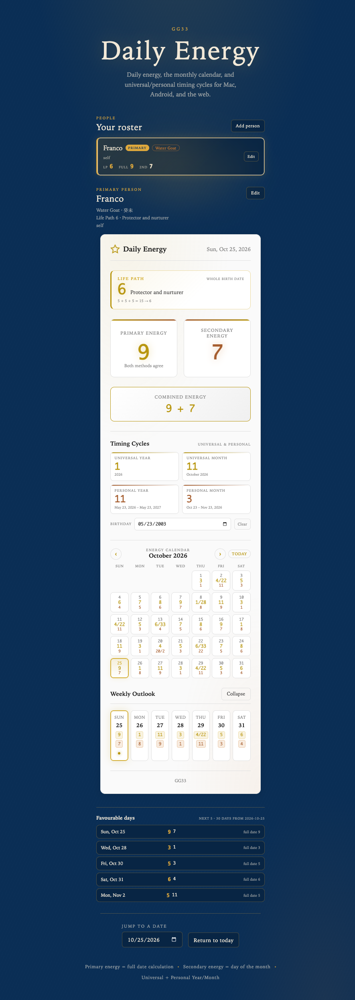
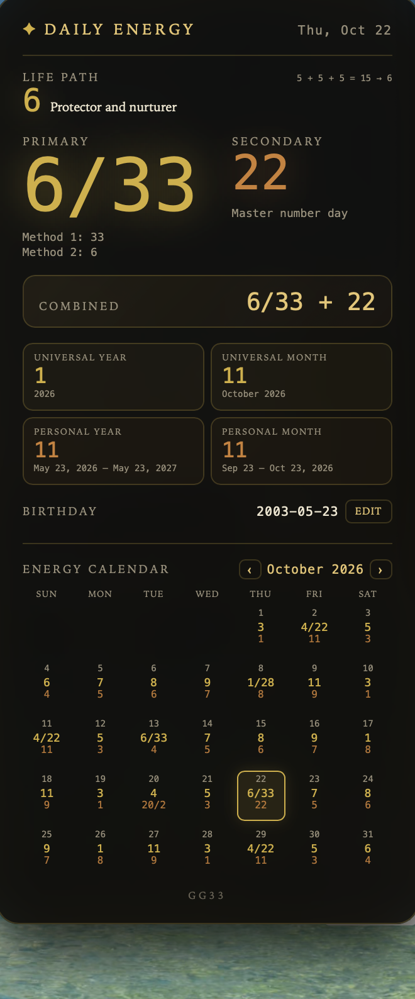
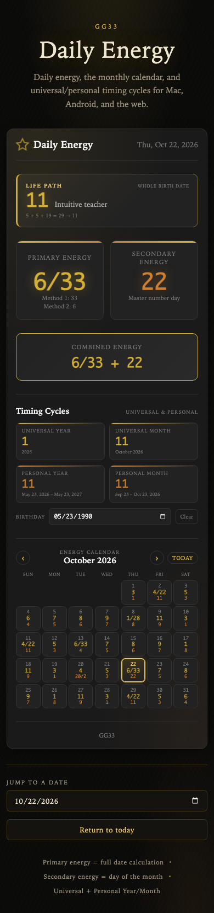

# Daily Energy — Numerology Widget

Daily energy numerology for **macOS**, **Android**, and the **web**, based on the
**GG33 / Gary the Numbers Guy (matrixprime)** system. The same calculation rules
are implemented in TypeScript for the web and macOS widgets and in Kotlin for
Android, with matching fixture suites.

It calculates the daily energy, your Life Path, and the universal and
personal timing cycles:

| Number | Calculation |
| --- | --- |
| **Life Path** | Whole birth date: reduced month + reduced day + the digits of the birth year. 11/22/33 stay whole; an exact total of 28 is the Wealth Life Path with a 1 underneath. Life Path is the primary birth number and outranks the birth-day Secondary Energy. |
| **Primary / Full Date Energy** | Month + day + digits of the year, run through the two-method dual-energy calculation |
| **Secondary Energy** | The day of the month (with the special 2nd = 11, 20th = 20/2, and 11/22/33 master-day rules) |
| **Universal Year (UY)** | All digits of the calendar year, reduced using the timing-cycle rule (2026 → 1) |
| **Universal Month (UM)** | Universal Year + the calendar month, reduced using the timing-cycle rule (October 2026 → 11) |
| **Personal Year (PY)** | Birth month + birth day + the year of the active birthday cycle; changes on your birthday |
| **Personal Month (PM)** | Personal Year + the month the current birthday-to-birthday cycle began; changes on your birth day each month |

Every widget also includes an **energy calendar**. The web widget shows the
current month, can change months, and lets you click a day to update the main
numbers; the macOS widget shows a month you can page through; the Android
calendar widget shows **five rolling days** with ‹ / › controls.

It ships in these forms:

| Platform | Form | Native OS widget? |
| --- | --- | --- |
| **macOS** | Übersicht desktop widget | Yes — desktop |
| **Android / Pixel** | Kotlin App Widgets (APK) | Yes — home screen, 4×2 daily + 4×4 calendar |
| **iPhone, iPad, Windows, Linux** | Web app / home-screen shortcut | No |
| **Any browser** | `<numerology-widget>` custom element | No |

## Agent surfaces

Three more surfaces call the same engine. No rule lives outside
`src/numerology-core.ts`:

| Surface | Path | What it is |
| --- | --- | --- |
| **CLI** | `tool/numerology-cli.mjs` | JSON on stdout for shell scripts, cron and non-Node agents — [docs/cli.md](docs/cli.md) |
| **MCP server** | `mcp/server.mjs` | Two tools (`user_profile`, `numerology_query`) over stdio for Claude Code / Cursor / Pi — [docs/mcp.md](docs/mcp.md) |
| **The Chart** | `app/` | Pi SDK planning agent that turns cycle data into dated decisions — [docs/app.md](docs/app.md) |

```bash
npm install && npm run build
node tool/numerology-cli.mjs profile '{}'
npm run app -- --dry        # timing brief without a model
```

Background: [architecture](docs/architecture.md) ·
[numerology rules in plain English](docs/numerology-rules.md) ·
[how an agent should call these](docs/agent-integration.md)



## Install

### macOS — desktop widget

The Mac widget uses [Übersicht](https://tracesof.net/uebersicht/), a free app
that renders HTML/JS widgets on the desktop. It needs macOS 12 or newer.

```bash
brew install --cask ubersicht

# From the project folder:
./scripts/install-uebersicht.sh
```

The installer copies `uebersicht/DailyEnergy.widget` into
`~/Library/Application Support/Übersicht/widgets/`. Übersicht reloads it
automatically; if it does not appear, choose **Refresh all Widgets** from the
Übersicht menu.

It appears 28 px from the top-right corner and refreshes once a minute, so the
date rolls over at local midnight. It shows your Life Path, today's daily
energy, the four timing cycles, and a month calendar with previous/next controls.
The footer reads **GG33**.

Life Path, Personal Year, and Personal Month need a birthday. You can set it
directly in the macOS widget: enable **Interaction** in the Übersicht menu-bar
settings (grant Accessibility access if macOS asks), click **Set** / **Edit**
next to **Birthday**, enter `YYYY-MM-DD` (for example `2003-05-23`), and press
**Save**. The year is required for Life Path; Personal Year/Month still use only
the month and day. The calendar arrows and the **Today** reset also use
Interaction.

The form stores the value in the widget's `localStorage`, so it survives
reloads and widget updates. The build-time value is the fallback for a fresh
install. To change that fallback, create `uebersicht/birthday.txt` (gitignored)
with `YYYY-MM-DD`:

```bash
echo "2003-05-23" > uebersicht/birthday.txt
npm run build:uebersicht
./scripts/install-uebersicht.sh
```

Or pass it as an environment variable:

```bash
BIRTHDAY=2003-05-23 npm run build:uebersicht
./scripts/install-uebersicht.sh
```

Legacy `MM-DD` fallback values still drive Personal Year/Month, but the Life
Path card will ask for the birth year. Without a birthday, the cards show
**—** and **Set birthday**.

If you edit the widget template, rebuild and reinstall:

```bash
npm install
npm run build:uebersicht
./scripts/install-uebersicht.sh
```

<p align="center">
  
</p>

See [`uebersicht/README.md`](uebersicht/README.md) for customization and
uninstall steps.

### Android / Pixel — home-screen widget

This is a real native App Widget, not a browser shortcut.

**Option A — install the APK**

1. Download `DailyEnergy-1.1.apk` from the repository's Releases page, or use
   the locally built `dist/DailyEnergy-1.1.apk`.
2. Transfer it to the phone and tap it. Allow "Install unknown apps" for the
   file manager or browser you used.
3. Or install over USB:

   ```bash
   adb install -r dist/DailyEnergy-1.1.apk
   ```

4. Open **Daily Energy** and tap **Set birthday**. Pick the full date. The year
   drives Life Path; Personal Year and Personal Month still use only the month
   and day.
5. Long-press an empty area of the home screen → **Widgets** →
   **Daily Energy**. Add either:
   - **Daily Energy** — a 4×2 card with today's primary/secondary/combined
     energy and `LP`. If you resize it to three or more rows, the compact
     `LP / UY / UM / PY / PM` line appears.
   - **Daily Energy Calendar** — a 4×4 card with five rolling days you can move
     with ‹ / ›, plus today's energy, `LP`, and the four timing cycles.

Tap either card to open the full-screen app; tap **↻** to refresh immediately.
The widgets update themselves at 12:01 a.m. local time, with a 30-minute system
update as a fallback. The app also shows the four cycles and the date ranges
for the personal cycles.

The first time you open the app, Life Path shows **—** and the personal cycles
show **Set birthday** until you pick a full birth date. The widgets show
**LP — / PY — / PM —** in the same way.

The provided APK is signed with a local debug key so it can be sideloaded. That
is fine for personal use; replace the signing config before publishing to Google
Play.

**Option B — build from source**

Requirements: JDK 17, Android SDK platform 35, and build-tools 35.0.0.

```bash
# From the repo root, if the SDKs are on your PATH or in local.properties:
npm run build:android
# APK: dist/DailyEnergy-1.1.apk
```

Or build directly:

```bash
cd android
./gradlew testDebugUnitTest assembleRelease
# APK: app/build/outputs/apk/release/app-release.apk
```

See [`android/README.md`](android/README.md) for details.

**Option C — web shortcut**

If you do not want to sideload an APK, host the web version (below) and use
Chrome's **Add to Home screen**. It still opens like an app, but it is not a
native home-screen widget.

### iPhone / iPad

There is no native iOS widget in this repo; that would require a separate
WidgetKit app. The web version works well as a home-screen shortcut:

1. Host the web build somewhere with HTTPS (see below).
2. Open it in Safari.
3. **Share → Add to Home Screen**.

### Windows / Linux

Open `standalone/index.html`, or host the web build and use Chrome/Edge's
**Install page as app** / **Add to Home screen** option.

## Web version

The fastest look, with no build step:

```bash
open standalone/index.html
```

`standalone/index.html` loads the prebuilt `numerology-widget.iife.js`, so
double-clicking it works too.

For development:

```bash
npm install
npm run dev          # demo at http://localhost:5174, bound to your LAN
```

To publish a static site:

```bash
npm run build:demo   # writes demo-dist/
```

Upload `demo-dist/` to Cloudflare Pages, Netlify, Vercel, GitHub Pages, or any
static host. Vite is configured with a relative base, so it works from a
subdirectory such as `https://you.github.io/numerology-widget/`.

The web widget shows the current month's calendar by default. Use the
previous/next arrows to browse, **Today** to return, and click any day to update
the main numbers and timing cycles. Add `hide-calendar` if you only want the daily
numbers. The optional `show-weekly` seven-day view remains available for
compact embeds.

Set a full birthday in the **Birthday** field under the cycle cards. The demo
stores it in `localStorage`; the embedded widget emits a `birthday-change`
event so your own page can persist it. The year unlocks Life Path; Personal
Year/Month use only the month and day.

On a phone, open the hosted page in Chrome and choose **Add to Home screen**.
HTTPS is required for a permanent hosted install; `file://` is fine for the
basic widget.

<p align="center">
  
</p>

## Publish this repo

The local git repository is already initialized. Create an empty repository on
GitHub, then:

```bash
git remote add origin git@github.com:<your-account>/numerology-widget.git
git push -u origin main
```

Publish the APK as a GitHub Release so it has a stable download link:

```bash
gh release create v1.1.0 dist/DailyEnergy-1.1.apk \
  --title "Daily Energy v1.1.0" \
  --notes "Monthly calendar on every widget, Universal/Personal Year and Month cycles, and a new Android 4×4 calendar widget."
```

If you use a different version, update `versionName` in
`android/app/build.gradle.kts` and the APK filename in the commands above.

## Posting agent

[`agent/`](agent/README.md) contains a repo-aware posting agent for X. It reads
today's numbers and recent repository activity, asks an OpenAI-compatible model
for one post, validates it, and publishes through X API v2. Local runs are
dry-run by default; GitHub Actions can run it on a daily schedule. In Actions it
uses GitHub Models through the built-in token by default, so the only required
secrets are the four X credentials.

```bash
npm install
npm --prefix agent install
npm run build

npm run agent:preview   # print the data and prompt, no network
npm run agent:dry       # generate a post, do not publish
npm run agent:post      # publish
```

See [`agent/README.md`](agent/README.md) for X app permissions, secrets, costs,
and the schedule.

## Development

```bash
npm install
npm test             # calculation tests
npm run typecheck
npm run lint
npm run build        # library + standalone IIFE + Übersicht widget
npm run build:demo   # static demo site in demo-dist/
npm run build:uebersicht
npm run build:android
npm run install:uebersicht
```

After changing `src/`, run `npm run build` so
`standalone/numerology-widget.iife.js` and the Übersicht widget stay current.

## Stack

- **TypeScript 5** — strict calculation engine and web component.
- **Vite 5** — library build (ESM/CJS/types), standalone IIFE, and demo site.
- **Web Components** — `<numerology-widget>` with Shadow DOM; no framework
  required at runtime.
- **React 19 wrapper** — optional `numerology-widget/react` entry.
- **Vitest** — 50 calculation, calendar, timing-cycle, and Life Path tests.
- **esbuild** — bundles the core into the Übersicht widget.
- **Übersicht** — macOS desktop widget host (HTML/JS/JSX).
- **Kotlin + RemoteViews** — native Android App Widget; no AndroidX or Compose
  runtime dependencies.
- **Gradle / AGP / JUnit** — Android build and 27 calculation/calendar/cycle/Life Path tests.
- **Plain CSS** — occult-gold theme, light/dark support, mobile breakpoints,
  keyboard/ARIA support, and reduced-motion support.

The web core has no runtime dependencies.

## Embedding

### Single script tag (no build step for the consumer)

Copy `standalone/numerology-widget.iife.js` (or `dist/numerology-widget.iife.js`)
next to your HTML:

```html
<script src="./numerology-widget.iife.js"></script>

<numerology-widget birthday="2003-05-23" auto-refresh></numerology-widget>
```

### ES module

```html
<script type="module">
  import 'numerology-widget/web-component';
</script>

<numerology-widget date="2026-10-22" birthday="2003-05-23" compact></numerology-widget>
```

### React

```tsx
import { NumerologyWidget } from 'numerology-widget/react';

export function EnergyPanel() {
  return (
    <NumerologyWidget
      birthday="2003-05-23"
      autoRefresh
      onDateChange={(date) => console.log('selected', date)}
      onBirthdayChange={(birthday) => console.log('birthday', birthday)}
    />
  );
}
```

### Core only (Node, Bun, Deno, workers)

```ts
import {
  calculateNumerologyEnergies,
  calculateCycleEnergies
} from 'numerology-widget';

const today = calculateNumerologyEnergies(new Date());
console.log(today.fullDateEnergy.displayValue); // e.g. "3"
console.log(today.secondaryEnergy.displayValue); // e.g. "1"
console.log(today.combinedKey);                  // "3 + 1"

const cycles = calculateCycleEnergies(new Date(), '2003-05-23');
console.log(cycles.universalYear.displayValue);  // "1"
console.log(cycles.universalMonth.displayValue); // "11"
console.log(cycles.personalYear?.displayValue);  // "11"
console.log(cycles.personalMonth?.displayValue); // "11"
console.log(cycles.personalMonth?.dateLabel);    // "Sep 23 – Oct 23, 2026"
```

## Attributes

| Attribute | Description |
| --- | --- |
| `date="YYYY-MM-DD"` | Date to display. Defaults to today. |
| `birthday="YYYY-MM-DD"` or `"MM-DD"` | Birthday for Life Path and Personal Year/Month. Use `YYYY-MM-DD` for Life Path; `MM-DD` still works for personal cycles only. |
| `compact` | Tighter padding for sidebars. |
| `show-weekly` | Show the optional seven-day outlook on load. |
| `hide-calendar` | Hide the monthly energy calendar. |
| `hide-cycles` | Hide the Universal/Personal cycle cards. |
| `auto-refresh` | Re-render at local midnight and every 24 hours. |

## Public API

```ts
const widget = document.querySelector('numerology-widget');

widget.setDate('2026-10-22'); // jump to a date
widget.goToToday();
widget.nextDay();
widget.previousDay();
widget.nextMonth();           // calendar navigation
widget.previousMonth();
widget.refresh();
widget.setBirthday('2003-05-23'); // Life Path + Personal Year/Month
widget.setBirthday(null);         // clear it
widget.getDate();                 // "2026-10-22" (local calendar date)
widget.getVisibleMonth();         // "2026-10-01" (first of the visible month)
widget.getBirthday();             // "2003-05-23" or null
widget.getEnergies();             // daily calculation result
widget.getCycles();               // Universal/Personal cycle result
widget.getLifePath();             // Life Path result, or null without a full date
```

Events:

```ts
widget.addEventListener('date-change', (event) => {
  console.log(event.detail.date);
});

widget.addEventListener('birthday-change', (event) => {
  console.log(event.detail.birthday); // "2003-05-23" or null
});
```

## Calculation rules (ported verbatim)

### Life Path

Life Path uses the whole birth date and is the primary birth number. The
birth-day Secondary Energy is a separate daily signal and does not replace it.

- Reduce the birth **month** and **day** separately. **November stays 11**; a
  day of **11 or 22** stays whole. Other values break into digits.
- Sum the digits of the birth **year** and keep that sum as the year component.
  It is not reduced again, so 1963 → 19 and 1847 → 20. A year that totals
  11/22/33 therefore stays whole.
- Add the three components and reduce the total, stopping at **11, 22, or 33**.
- An exact total of **28** is the **Wealth Life Path**, displayed as `28` with a
  **1 underneath**. It is not reduced to 1 or called a master number.
- A final total of **2** reads as **11**, including `20 → 2 → 11`. There is no
  Life Path 2.
- **33** keeps a 6 underneath, but it is never called just 6.
- Personal Year and Personal Month still use only the birth month and day.

Examples:

| Birth date | Components | Total | Life Path |
| --- | --- | --- | --- |
| 2003-05-23 | 5 + 5 + 5 | 15 | **6** |
| 1963-02-17 | 2 + 8 + 19 | 29 | **11** |
| 1847-02-11 | 2 + 11 + 20 | 33 | **33** |
| 1935-02-08 | 2 + 8 + 18 | 28 | **28** (1 underneath) |

### Full date energy

Two methods are always calculated:

1. **Method 1 — break down non-masters:** month and day are kept whole only if
   they are 11/22/33; the year is always summed as digits. The total is then
   reduced.
2. **Method 2 — keep everything whole:** `month + day + digitSum(year)` with no
   reduction.

- If both methods agree, a single number is shown.
- If they differ, the display is `smaller/larger` (for example `1/28`, `6/33`).
- Multiples of 10 reduce to a single digit (`40 → 4`).
- A sum of **20** displays as `20/2` and is numerologically **11**.
- **28** is kept whole for the full-date calculation only.

### Secondary energy

- Day **2** → `11`
- Day **20** → `20/2` (numerologically 11)
- Days **11, 22, 33** → shown as master numbers
- Every other day reduces normally — including **day 28**, which becomes
  `2+8 = 10 → 1`

### Timing cycles

These are the rules used for the Universal/Personal Year and Month cards:

- Count every digit.
- **11, 22, and 33 stay whole.**
- A total that reduces to **2 reads as 11**. That includes 20 → 2 → 11.
- **28 is not special** for these cycles; it reduces like any other number.
- **Universal Year** = all digits of the calendar year. 2026 → 2+0+2+6 =
  10 → 1. 2027 → 11, which stays 11.
- **Universal Month** = Universal Year + the calendar month (reduced). October
  2026: 1 + 1 = 2 → 11. It changes on the 1st for everyone.
- **Personal Year** = birth month + birth day + the year of the active
  birthday-to-birthday cycle. For a May 23 birthday on Oct 22, 2026:
  5 + 2 + 3 + 2 + 0 + 2 + 6 = 20 → 2 → 11. It changes on May 23, not
  January 1.
- **Personal Month** = active Personal Year + the month in which the current
  birthday-to-birthday cycle began. For the Sep 23–Oct 23, 2026 cycle:
  11 + 9 = 20 → 11. It changes on the 23rd each month, not the 1st. The next
  cycle starts Oct 23 and uses October: 11 + 10 = 21 → 3.

The displayed date range is the cycle boundary: for example,
`Sep 23 – Oct 23, 2026` means the new cycle starts on Oct 23.

### Locked-in calculation fixtures

The tests pin these known outputs across the web and Android engines:

| Date | Full date | Secondary |
| --- | --- | --- |
| 2025-11-08 | 28 | 8 |
| 2025-11-12 | 5 | 3 |
| 2025-12-07 | 1/28 | 7 |
| 2025-11-11 | 4 | 11 |
| 2025-09-15 | 6/33 | 6 |
| 2025-09-22 | 4 | 22 |
| 2025-02-09 | 20/2 | 9 |
| 2026-10-28 | 3 | 1 |

Life Path fixtures:

| Birth date | Life Path |
| --- | --- |
| 2003-05-23 | 6 |
| 1963-02-17 | 11 |
| 1847-02-11 | 33 |
| 1935-02-08 | 28 (1 underneath) |

The web suite has 50 tests; the Kotlin port has 27 tests, including the calendar
grid, timing-cycle, and Life Path fixtures.

## Project structure

```
numerology-widget/
├── src/
│   ├── numerology-core.ts        # zero-dependency calculation engine
│   ├── web-component.ts          # <numerology-widget> custom element
│   ├── react.tsx                 # React wrapper
│   └── __tests__/
│       └── numerology-core.test.ts
├── demo/                         # occult-gold demo page
├── standalone/                   # open index.html directly, no build
│   ├── index.html
│   └── numerology-widget.iife.js
├── uebersicht/                   # macOS desktop widget
│   ├── widget.template.jsx
│   ├── birthday.txt              # local, gitignored
│   ├── DailyEnergy.widget/       # generated
│   └── README.md
├── agent/                        # repo-aware X posting agent
│   ├── post.mjs                  # generate, validate, publish
│   ├── persona.md                # voice and content rules
│   ├── .env.example              # credential template
│   └── README.md
├── android/                      # native Android App Widgets
│   ├── app/src/main/...          # Kotlin, RemoteViews, resources
│   │   ├── DailyEnergyWidgetProvider.kt
│   │   ├── DailyEnergyCalendarWidgetProvider.kt
│   │   ├── CalendarMonth.kt
│   │   ├── Cycles.kt
│   │   ├── LifePath.kt
│   │   └── BirthdayStore.kt
│   ├── app/src/test/...          # 27 JUnit tests
│   ├── gradlew
│   └── README.md
├── scripts/
│   ├── build-uebersicht.mjs
│   ├── build-android.sh
│   └── install-uebersicht.sh
├── docs/                         # preview screenshots
├── vite.config.ts                # library build (ESM + CJS + types)
├── vite.standalone.config.ts     # single-file IIFE build
├── vite.demo.config.ts           # demo dev server / static build
└── package.json
```

## Design notes

The web widget uses Shadow DOM so page styles cannot leak in or out. The theme
uses an occult-gold palette (`#D4AF37`, charcoal, bronze), with a light-mode
variant via `prefers-color-scheme`. Typography uses serif display
text and monospace numerals, chosen from fonts available offline on macOS and
Android.

The Android widgets intentionally avoid Compose/Glance to keep the APK small
and the build simple: they are classic `AppWidgetProvider` + `RemoteViews`
apps. The 4×4 calendar is drawn to a bitmap with Canvas so a seven-column grid
stays legible without dozens of RemoteViews. The calculation engine is
duplicated in Kotlin, with the same fixtures as the TypeScript tests.

The web calendar and cycle cards live inside the same Shadow DOM component so
the widget remains portable as a single custom element. The web component
persists nothing by itself; the demo and standalone page store the birthday in
`localStorage`. The macOS widget also stores an in-widget birthday override in
`localStorage`, with `uebersicht/birthday.txt` or `BIRTHDAY` as its build-time
fallback.

## Credits

Calculation system: **GG33** — Gary the Numbers Guy / [@matrixprime](https://x.com/matrixprime).

## License

MIT — see [LICENSE](LICENSE).
